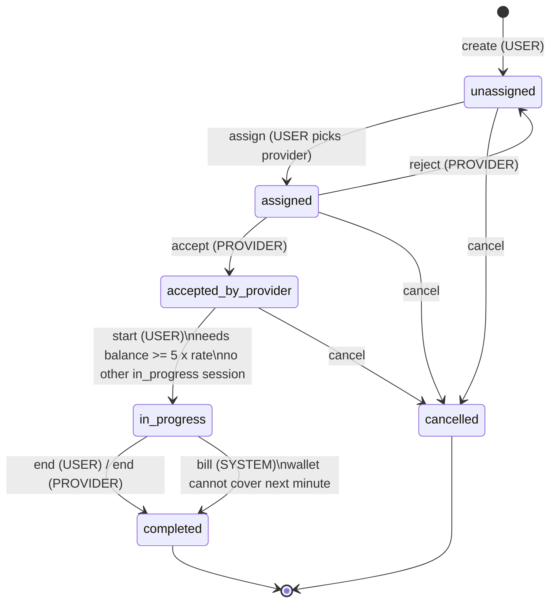
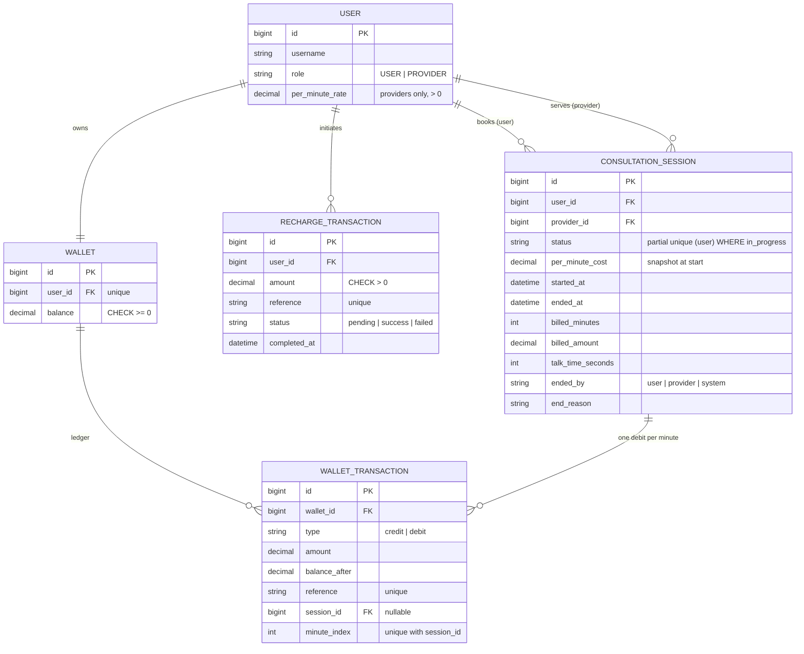

# Design notes

## Session state diagram

Any action not drawn above returns **HTTP 400** with `{"error": "invalid_transition", "detail": "..."}`.
The whole table is in [`consultations/state_machine.py`](../consultations/state_machine.py).

## ER diagram

## Implementation decisions

**1. A thin service layer.** Views only parse input and call functions in
`wallet/services.py` and `consultations/services.py`. All rules (state checks,
balance checks, billing) live there, so the API and the cron command share one
code path. Services raise `DomainError` subclasses, and one DRF exception
handler maps them to 400/403/404 JSON responses.

**2. A declarative state machine.** Transitions are a single dict
`action -> (allowed_from_states, to_state)`. Who can perform an action (user vs
assigned provider) is checked first and returns 403. Whether the action is valid
in the current state is checked second and returns 400. This keeps "you aren't
allowed" separate from "that's not possible right now".

**3. Money safety is layered.**
- Amounts are `Decimal` everywhere. No floats.
- Every balance change goes through `credit()`/`debit()`. `debit()` refuses to
  overdraw.
- A DB `CHECK (balance >= 0)` constraint is the final safety net.
- Each change writes an append-only `WalletTransaction` row with
  `balance_after`, so the balance can be audited and reconstructed.

**4. Concurrency.** Every mutation runs in `transaction.atomic()` and takes row
locks with `select_for_update()`. The lock order is always session → wallet and
recharge → wallet, so two operations cannot deadlock against each other. On
PostgreSQL these locks are real row locks. On SQLite, writes are serialised by
the database itself.

**5. Idempotency, at two levels.**
- *Recharge callback.* The recharge row is locked. If its status already equals
  the incoming status, the callback is a duplicate and returns `200` with
  `"duplicate": true` and no side effect. A finalized recharge cannot flip
  (failed→success returns 400). The credit's ledger reference
  `recharge:<reference>` is unique, so a double credit is impossible even if the
  logic above had a bug.
- *Billing.* The session stores `billed_minutes`. A billing tick charges only
  minutes `billed_minutes+1 … floor(elapsed/60)`. Each minute's debit has the
  unique reference `session:<id>:minute:<n>` and a unique `(session, minute_index)`
  constraint, so the same minute can never be charged twice.

**6. Billing model.** Billing is in arrears per *completed* minute. After each
tick, if `balance < per_minute_cost`, the next minute cannot be paid, so the
system ends the session: `status=completed`, `ended_by=system`,
`end_reason=insufficient_balance`. Example: ₹290 at ₹50/min is billed 5 minutes,
then ends with ₹40 left. A trailing partial minute when the session ends is not
charged. This is customer-friendly and, combined with the 5-minute starting
minimum, means the wallet never needs to go negative.

**7. Late or missed ticks.** If billing runs late, every overdue minute is
charged in one go, up to what the wallet can afford. The session then ends.
`talk_time_seconds` stores the real wall-clock duration and `billed_minutes`
stores the paid duration, so any unpaid gap is visible. Running
`bill_active_sessions` every minute keeps that gap under one minute. A
production system would use a scheduler (Celery beat, etc.) and could
pre-authorise the next minute instead.

**8. Rate snapshot.** Providers have a `per_minute_rate`. It is copied into
`session.per_minute_cost` at `start`, so rate changes never affect a running
session. The 5× minimum-balance check uses the same snapshot value.

**9. One active session per user.** Starting a session locks the user's wallet,
which serialises concurrent starts for that user, and then checks for an existing
`in_progress` session. A partial unique index `UNIQUE(user) WHERE status='in_progress'`
backs this up at the database level.

**10. Auth.** DRF token authentication with `USER` and `PROVIDER` roles on a
custom user model. The mock gateway webhook does not use a user token. It is
authenticated with a shared secret in the `X-Webhook-Secret` header, compared in
constant time.
